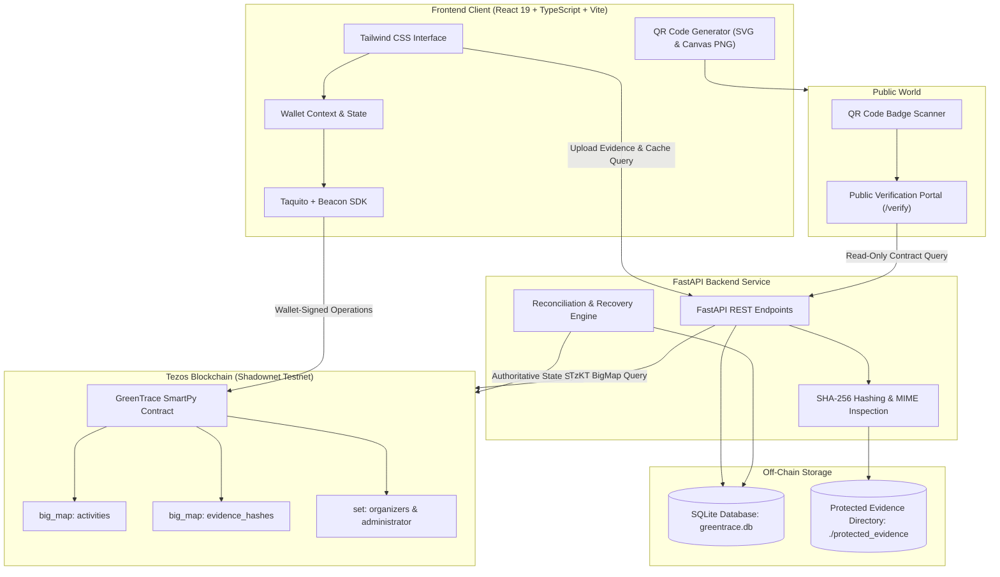
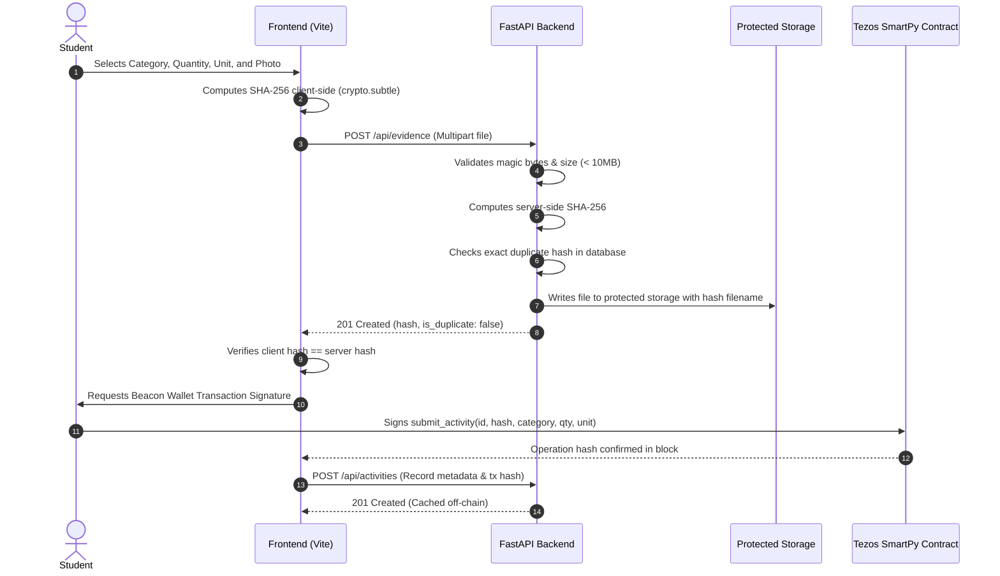
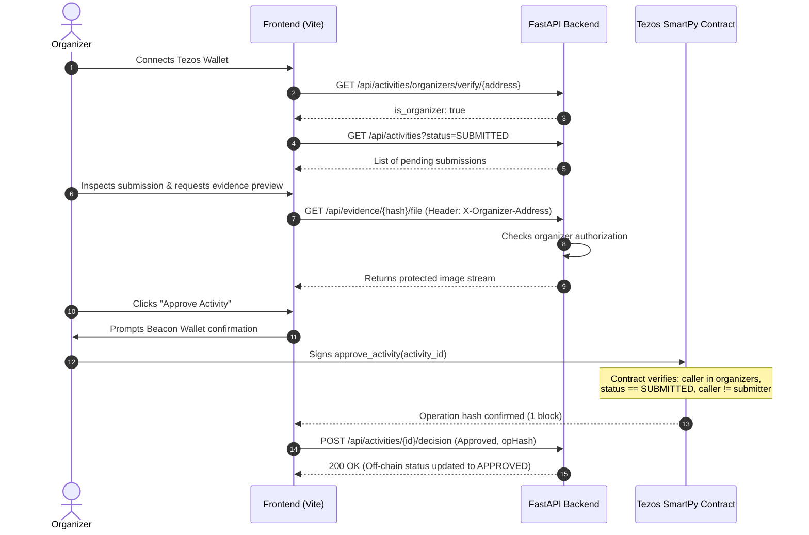
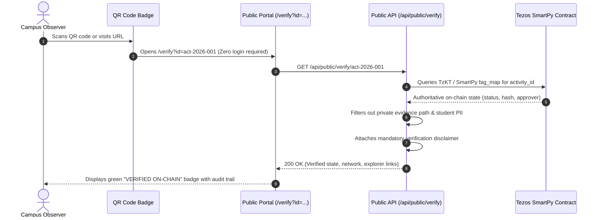

# GreenTrace 2.0 — System Architecture Specification

## 1. Executive Architecture Overview

GreenTrace 2.0 is a decentralized campus sustainability verification platform built on the **Tezos** blockchain (Shadownet testnet), combining cryptographic on-chain immutability with secure, privacy-preserving off-chain storage.

---

## 2. On-Chain vs. Off-Chain Data Separation

To maximize user privacy, minimize blockchain transaction storage fees, and maintain cryptographic auditability, data is divided between on-chain storage and secure off-chain storage:

| Data Element | Storage Location | Privacy & Security Rationale |
|---|---|---|
| **Activity ID** (`act-...`) | On-Chain & Off-Chain | Unique key identifying the activity across both systems. |
| **Evidence SHA-256 Digest** | On-Chain & Off-Chain | 64-character lowercase hexadecimal hash. Proves photographic authenticity without exposing image contents. |
| **Category & Quantity & Unit** | On-Chain & Off-Chain | Quantitative sustainability impact verified on-chain. |
| **Status** (`SUBMITTED`, `APPROVED`, `REJECTED`) | On-Chain (Authoritative) & Off-Chain (Cache) | SmartPy contract enforces state transitions; SQLite mirrors confirmed state. |
| **Submitter Tezos Address** | On-Chain & Off-Chain | Derived directly from `sp.sender` on Tezos; no passwords or emails stored. |
| **Approver Tezos Address** | On-Chain & Off-Chain | Derived from `sp.sender` of authorized organizer upon decision. |
| **Raw Photographic Evidence** | Off-Chain Protected Storage | **Never placed on-chain.** Stored on server filesystem; access restricted to authorized organizers. |
| **Detailed Text Description** | Off-Chain SQLite | Reduces gas fees and storage overhead. |
| **Rejection Reason** | Off-Chain SQLite | Sensitive feedback visible only to the submitter and organizer. |
| **Operation Hashes & Timestamps** | On-Chain & Off-Chain | Full audit trail linking actions to Tezos block explorer (TzKT). |

---

## 3. Core Subsystems

### A. Frontend Client (`frontend/src/`)
- **React 19 & TypeScript:** Strict typing with verbatim module syntax and Tailwind CSS v4 styling.
- **Beacon SDK & Taquito (`services/tezos.ts`):** Direct communication with browser wallet extensions (Kukai, Temple, Umami) configured for Tezos Shadownet (`https://rpc.shadownet.teztnets.com`).
- **Role Resolution Engine:** Evaluates connected wallet address against smart contract permissions. If authorized in the contract organizer set, grants `ORGANIZER` access; otherwise grants `STUDENT` access.
- **Zero-Auth Public Verification Portal (`pages/PublicVerifyPage.tsx`):** Standalone portal accessible to any observer without logging in or connecting a wallet.
- **Client-Side QR Code Engine:** Uses `@types/qrcode.react` to render scalable SVG badges with client-side canvas rasterization for PNG downloads.

### B. SmartPy Smart Contract (`contracts/greentrace.py`)
- **Language:** SmartPy v0.24+ module syntax compiling to Michelson bytecode.
- **Entrypoints:**
  - `submit_activity(params)`: Enforces unique activity ID, unique SHA-256 evidence fingerprint, positive quantity, valid category, and valid unit pairing.
  - `approve_activity(activity_id)`: Requires caller to be in `self.data.organizers`, activity status to be `SUBMITTED`, and prevents self-approval (`sp.sender != submitter`).
  - `reject_activity(activity_id)`: Requires caller to be an authorized organizer; records permanent rejection.
  - `add_organizer(organizer)` / `remove_organizer(organizer)`: Administrator-only access control.
- **On-chain Views:** `is_organizer`, `get_activity`, `has_evidence_hash`.

### C. Backend API Service (`backend/app/`)
- **FastAPI (Python 3.12):** Asynchronous ASGI REST server.
- **MIME & Magic-Byte Validation (`services/hashing.py`):** Inspects actual file bytes (PNG `\x89PNG`, JPEG `\xff\xd8\xff`, WebP `RIFF...WEBP`) preventing executable scripts from being uploaded.
- **SHA-256 Hashing Engine:** Computes RFC 6234 / NIST standard SHA-256 digests. Verifies that client-computed hashes match server-computed bytes before accepting submissions.
- **Protected Evidence Server (`routes/evidence.py`):** Strictly protects raw student images behind `X-Organizer-Address` header validation.

### D. SQLite Off-Chain Database (`backend/app/database.py`)
- **Database Schema:**
  - `activities`: Stores activity metadata, submitter address, category, quantity, unit, status cache, transaction hashes, and timestamps.
  - `evidence`: Stores SHA-256 fingerprints, sanitized filenames, local disk paths, file sizes, and MIME types.
  - `transactions`: Complete transaction ledger recording activity ID, operation hash, operation type, confirmation status, and timestamps.
  - `reconciliation_logs`: Audit log of automatic reconciliation runs detecting discrepancies between local cache and Tezos on-chain state.

---

## 4. Workflows & Sequences

### 1. Student Activity Submission & Evidence Fingerprinting

### 2. Organizer Review & Wallet-Signed Decision

### 3. Public QR Verification Workflow

---

## 5. Security Architecture Summary

1. **Defense in Depth:** Validation is implemented symmetrically:
   - Client-side validation for instant user feedback.
   - FastAPI server-side validation for off-chain persistence and file parsing.
   - SmartPy smart contract validation for immutable on-chain enforcement.
2. **Access Control:** Role authorization is evaluated against the blockchain contract, never trusting client-side flags or manual dropdown selections.
3. **Data Privacy:** Raw photographic files and student contact details are stored off-chain only, shielding student privacy while providing verifiable cryptographic proof to the public.
